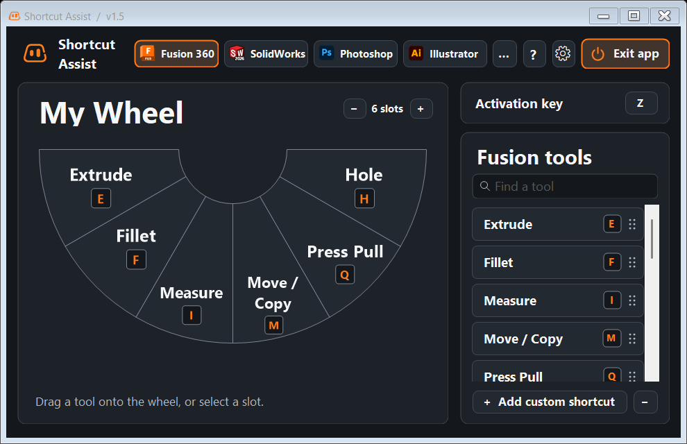

# Shortcut Assist v1.5

Shortcut Assist gives you a shortcut wheel for Fusion 360, SolidWorks, Photoshop, Illustrator, and other Windows programs you add. Set up a wheel for each program, then open it at your cursor while you work.

**[Download Shortcut Assist for Windows](./Shortcut-Assist.exe?raw=true)**

Open `Shortcut-Assist.exe` after it downloads. It runs directly on 64-bit Windows.

## Get started

1. Select a program and drag tools from the library onto the wheel. You can also select a wedge and then click a tool to assign it.
2. Switch to that program and press **Z**, the default activation key. Click a wedge to run its shortcut.
3. Open **Settings** to change the activation key or turn on the Mini HUD. Click **?** for a guided tour.

Each program has its own wheel and slot count. You can reorder wedges, add custom shortcuts and key sequences, or add more programs through **… → Manage programs**.

## Where settings are saved

Shortcut Assist saves your wheels, custom shortcuts, activation key, and preferences locally in a `data` folder beside the executable. Keep the app in a folder you can write to, such as Downloads or Documents. When moving the app, move the `data` folder with it. When updating, replace the executable in the same folder and keep `data`.
